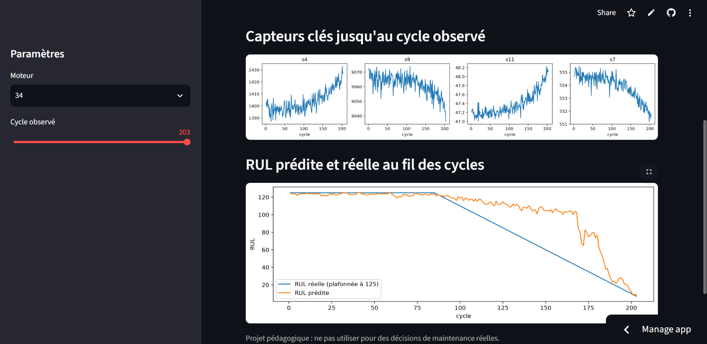

# Maintenance prédictive : estimer la durée de vie restante de moteurs

**Application de démonstration : https://maintenance-predictive.streamlit.app/**



## Problème

Un moteur d'avion s'use cycle après cycle. L'objectif est d'estimer sa **RUL** (*Remaining Useful Life*), c'est-à-dire le nombre de cycles avant la panne, à partir des mesures de ses capteurs. Cela permet de planifier la maintenance avant la panne.

## Données

NASA C-MAPSS, sous-ensemble FD001 : 100 moteurs en entraînement (suivis jusqu'à la panne) et 100 moteurs en test (coupés avant la panne). Chaque moteur a 21 capteurs et 3 réglages. Les données ne sont pas incluses dans ce dépôt.

Source : A. Saxena, K. Goebel (2008), *Turbofan Engine Degradation Simulation Data Set*, NASA Ames Prognostics Data Repository.

## Méthode

1. **RUL d'entraînement** : cycle maximum du moteur moins cycle actuel, plafonnée à 125 cycles (au début de vie, les capteurs ne montrent aucune usure).
2. **Nettoyage** : 7 colonnes constantes supprimées (reglage_3, s1, s5, s10, s16, s18, s19), ce qui laisse 15 capteurs.
3. **Features** : pour chaque capteur, moyenne mobile et écart-type sur 5 cycles, calculés moteur par moteur (45 features).
4. **Validation** : découpage par moteur (jamais par ligne), pour éviter la fuite de données entre cycles d'un même moteur.
5. **Modèles comparés** : régression linéaire (référence), Random Forest, Gradient Boosting.

## Résultats

Validation croisée par moteur (GroupKFold, 5 groupes), RMSE moyen en cycles :

| Modèle | RMSE |
|---|---|
| Random Forest | 18,72 (écart-type 0,49) |
| Gradient Boosting | 18,49 (écart-type 0,57) |

Test officiel (dernier cycle de chacun des 100 moteurs de test) :

| Modèle | RMSE | MAE |
|---|---|---|
| Régression linéaire | 20,99 | 16,64 |
| Random Forest | 18,22 | 12,90 |
| **Gradient Boosting** | **17,79** | **12,69** |

Le Gradient Boosting est retenu : l'erreur moyenne est d'environ 13 cycles sur une RUL plafonnée à 125.

**Capteurs les plus importants** (Random Forest) : s4 (62 % de l'importance), s9 (9,5 %) et s11 (7,7 %). Les 10 features principales sont toutes des moyennes mobiles.

## Application

L'application Streamlit permet de choisir un moteur et un cycle, puis affiche la RUL prédite, la RUL réelle, un statut (vert au-dessus de 60 cycles, orange entre 30 et 60, rouge sous 30), les courbes des capteurs clés et la comparaison prédiction/réalité au fil des cycles.

## Lancer le projet en local (Windows, PowerShell)

```
git clone https://github.com/Ornella-bit/maintenance-predictive.git
cd maintenance-predictive
python -m venv .venv
.venv\Scripts\activate
pip install -r requirements.txt
streamlit run app/streamlit_app.py
```

Pour exécuter le notebook, installez aussi `jupyter` et `ipykernel`, puis placez `train_FD001.txt`, `test_FD001.txt` et `RUL_FD001.txt` dans un dossier `data/`.

## Structure

```
maintenance-predictive/
├── notebooks/01_analyse_modele.ipynb   analyse, modèles, évaluation
├── app/streamlit_app.py                application de démonstration
├── app/donnees_demo.csv                données de test pour l'application
├── models/rul_model.joblib             modèle entraîné
├── docs/capture_app.png                capture de l'application
└── requirements.txt
```

## Limites et pistes d'amélioration

- Features simples (fenêtre de 5 cycles) et un seul régime de fonctionnement (FD001).
- Les premiers cycles d'un moteur donnent des prédictions instables, car la fenêtre glissante manque d'historique.
- Pistes : réseaux de neurones (LSTM, CNN 1D), réglage des hyperparamètres, sous-ensembles FD002 à FD004.

Projet pédagogique : ne pas utiliser pour des décisions de maintenance réelles.
